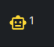
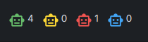

# DankMaterialShell Plugins

Plugins and an installable registry for
[DankMaterialShell](https://danklinux.com/). The [`plugins/`](plugins/) directory
contains the registry catalog; plugin source lives in its own subdirectory.

## Plugins

### [Herdr Status](herdr-status/)

A native DankBar widget that monitors agents in one local Herdr session.

- Colored bot icons with small superscript agent counts.
- A compact single-status mode, or separate icons in **green → yellow → red →
  blue** order for idle, working, blocked, and unread completed agents.
- A scrollable agent list and a dedicated settings view, opened with the gear
  icon beside the popout's close button.
- Display mode saved independently for each widget; horizontal and vertical bars
  are supported.

No agent plugin or helper daemon is required. Viewing the widget does not mark
results as read.

| Single status | Every status |
| --- | --- |
|  |  |

Requires Linux, DankMaterialShell **1.6+**, and a running Herdr **0.9.3+** session.

## Installation

### From this registry

This repository can be added directly to DMS as a **custom plugin registry**.
No local checkout or installation script is needed.

1. Register the repository once:

```sh
dms registry add marcobeierer https://github.com/marcobeierer/dankmaterialshell-plugins.git
```

2. Install Herdr Status:

```sh
dms plugins install herdrStatus
```

3. [Enable the widget](#enable-the-widget) and add it to DankBar.

Herdr must be installed separately and running. To update a registry-managed
installation later:

```sh
dms plugins update herdrStatus
```

#### Manual registry configuration

If your DMS build does not expose `dms registry add`, configure it through
`${XDG_CONFIG_HOME:-$HOME/.config}/DankMaterialShell/registries.json`. For a new
file, use:

```json
[
  {
    "name": "marcobeierer",
    "url": "https://github.com/marcobeierer/dankmaterialshell-plugins.git"
  }
]
```

If the file already exists, append the entry to its array, preserving existing
registries. Then run `dms plugins install herdrStatus`.

### From a local checkout (development)

From the repository root:

```sh
./herdr-status/install.sh
```

The installer symlinks the plugin into
`${XDG_CONFIG_HOME:-$HOME/.config}/DankMaterialShell/plugins`. Keep this repository
in place. To use a different plugins directory, pass it as an argument:

```sh
./herdr-status/install.sh "${XDG_CONFIG_HOME:-$HOME/.config}/dms/plugins"
```

Use either the development symlink or a registry-managed installation, not both
for the same plugin ID.

### Enable the widget

In DMS, open **Settings → Plugins**, scan for plugins, enable **Herdr Status**, and
add it to your DankBar layout.

Click the widget, then the **gear icon** to enable **Show every status** for that
widget. The default is a single icon for the highest-priority status. Executable,
session, and refresh interval are configured in the global plugin settings.

See the [Herdr Status README](herdr-status/README.md) for configuration, status
semantics, and troubleshooting.

## License

[MIT](LICENSE)
