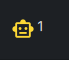
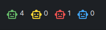

# Herdr Status for DankMaterialShell

A native DankBar widget for all local **Herdr** agents, regardless of which coding
agent they use. It combines the agents in the open **Herdr app** window
(`herdr-app`) with those in one **Herdr CLI** session (`herdr`); use either or
both. No OpenCode plugin, helper daemon, package
installation, or configuration changes to Herdr are required.

| Color | Agent status |
| --- | --- |
| Green | Idle |
| Yellow | Working |
| Red | An agent is blocked (or, in the app, reported an error) and needs attention |
| Blue | An agent has unread completed results |
| Gray | Neither Herdr source is available, or an agent's status is unknown |

Each status uses the same bot icon, with color indicating its state and a small
superscript number showing the agent count. Click for a scrollable agent list,
or right-click to refresh. It refreshes every two seconds by default. Opening the
widget does not acknowledge results or change Herdr focus.

## Display modes

- **Single status (default):** one bot for the highest-priority status, with the
  number of agents in that state. Priority is blocked, unread completed, working,
  unknown, then idle. No agents shows a green bot without a count.
- **Every status:** separate bots in **green → yellow → red → blue** order
  (idle, working, blocked, unread completed), each with a count, including zero
  by default. Enable **Hide zero-count statuses** to show only states with agents.
  A gray bot is appended when agents have unknown status.

Icons run across horizontal bars and stack on vertical bars. In either mode, a
single gray bot without stale counts means neither the app nor the CLI answered.
If only one answers, the widget shows its agents.

**Always hide idle status** removes the green icon in both modes, even when
there are idle agents. If no icons remain, the widget keeps a blank clickable
area for opening its agent list and settings. Otherwise, no agents keeps an idle
icon when zero-count statuses are hidden.

The agent list marks each agent **App** or **CLI**. App agents show their terminal
address and **space / tab**; CLI agents show their title, pane, and directory.

### Screenshots

Captured from a running DankBar widget on Hyprland.

| Single status | Every status |
| --- | --- |
|  |  |

## Install

Requires DankMaterialShell **1.6+** on Linux and at least one of:

- the Herdr app (`herdr-app`, tested with **0.1.16**) with its window open; the
  widget reads `herdr-app ls`. Agents keep running in herdr-core when the window
  is closed, but the widget can't see them until it opens again.
- a running Herdr CLI **0.9.3+** session; the widget reads `herdr agent list`.

Both are polled every interval, each in one short-lived child process.

### Custom repository (recommended)

Add this repository as a custom DMS registry, then install the plugin:

```sh
dms registry add marcobeierer https://github.com/marcobeierer/dankmaterialshell-plugins.git
dms plugins install herdrStatus
```

Register the repository only once. DMS downloads the plugin from the
`herdr-status` subdirectory; you do not need to clone the repository or run
`install.sh`. Herdr itself must be installed separately.

If `dms registry add` is unavailable in your build, use the
[manual registry configuration](../README.md#manual-registry-configuration).

For future updates:

```sh
dms plugins update herdrStatus
```

### Local checkout (development)

From this plugin directory:

```sh
./install.sh
```

The installer creates a symlink to this directory, so keep the source in place.
It is safe to rerun and refuses to overwrite another installation. It does not
install dependencies or restart the shell. For a custom plugins directory:

```sh
./install.sh "${XDG_CONFIG_HOME:-$HOME/.config}/dms/plugins"
```

Use either this development symlink or a registry-managed installation, not both.

### Enable the widget

In DMS, open **Settings → Plugins**, scan for plugins, and enable **Herdr Status**.
Add it to your DankBar layout. Both horizontal and vertical bars are supported.
If DMS uses a different configuration directory, pass its `plugins/` subdirectory
to the installer instead (newer Dux Shell releases use `~/.config/dms`).

## Settings

### Global plugin settings

Open **Settings → Plugins → Herdr Status** to configure:

- **Herdr app executable** and **Herdr CLI executable:** default to `herdr-app`
  and `herdr`. If one is not on DMS's `PATH`, use the absolute path returned by
  `command -v`, for example `/home/you/.local/bin/herdr-app`. These are paths,
  not shell commands; `~` is not expanded and arguments are not accepted here.
- **Herdr CLI session:** empty selects the CLI's default session. Set a name to
  monitor a different session. This widget does not aggregate multiple named
  sessions or saved SSH machines.
- **Refresh interval:** 1–30 seconds.
- **Override status colors:** off by default, following the DMS theme. Enable
  to show color pickers for idle, working, needs attention, results ready,
  unknown, and disconnected states. These colors apply to every Herdr widget
  and its agent list. Disable the override to restore theme colors without
  clearing your saved choices. States without a saved color still use the theme.

The CLI child process clears inherited `HERDR_SOCKET_PATH` and `HERDR_SESSION`
overrides so session selection is explicit. `HERDR_APP_HOME` in DMS's environment
selects which running Herdr app window is read. Custom Herdr config
locations via `HERDR_CONFIG_PATH` still follow the desktop environment.

### Per-widget display settings

1. Click the bot icon to open the agent list.
2. Click the **gear icon** next to the close button to open the dedicated settings
   view.
3. Toggle **Show every status** to switch display modes.
4. Optionally enable **Hide zero-count statuses** in every-status mode.
5. Optionally enable **Always hide idle status** in either mode.
6. Click the **back arrow** to return to the agent list, or close the popout.

Changes are saved automatically on that widget's DankBar entry and survive
reloads and restarts. Different widgets can use different display settings. Widgets
sharing the same bar entry across monitors share these settings. Display settings
are not global plugin settings.

## Status semantics

Aggregation and acknowledgement rules live in [`Status.js`](Status.js), with
tests in [`tests/`](tests/). The widget follows the status each source reports:
the app's terminal `status` in `herdr-app ls` and the CLI's `agent_status`. It
does not independently inspect terminal output or track completion history. Like
the app's own agents list, it counts an app agent's `error` as needing attention.
Sub-agents without their own pane in the app are not counted. Accuracy, including when
results count as viewed, therefore depends on Herdr and the agent's integration.
Agent titles, paths, and space and tab names stay local and are rendered as
plain text.

Run the tests with:

```sh
node --test herdr-status/tests/
```

## Troubleshooting

Run `herdr-app ls` and `herdr agent list` (or `herdr --session NAME agent list`)
from a terminal. If both fail, open the Herdr app or start the intended Herdr CLI
session. If one succeeds but the widget is gray or misses its agents, set an
absolute executable path in the plugin settings and right-click the widget.
Requests time out after five seconds and retry automatically. A failed request
never leaves stale counts. Unreadable output from either source is shown in red
above the agent list.

After editing the plugin, reload it with:

```sh
dms ipc call plugin-scan reload herdrStatus
```

If plugin settings still show an older version after editing their QML file,
fully restart DMS; reloading the plugin may leave the settings component cached.
After updating this plugin, run `dms restart` if the icon stays gray; a plugin
reload was not enough in testing.

## License

[MIT](../LICENSE) © 2026 Marco Beierer.
